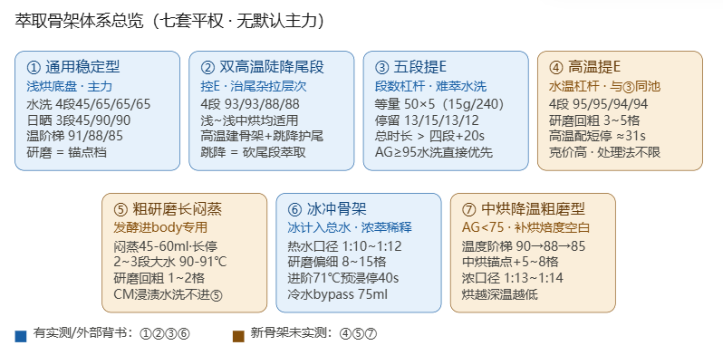
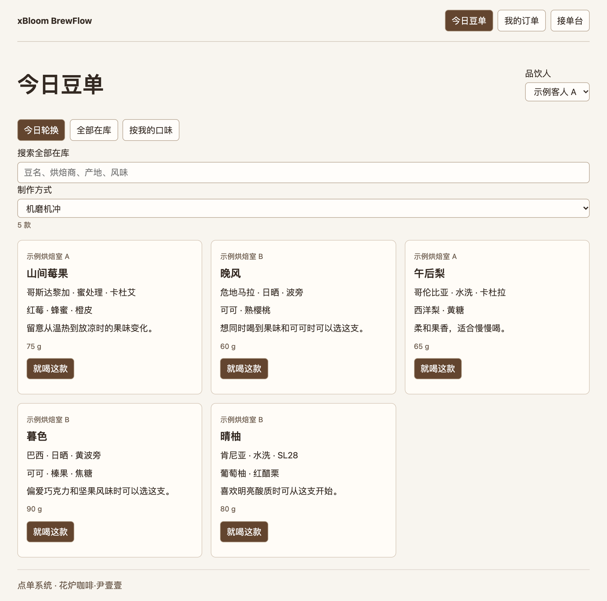
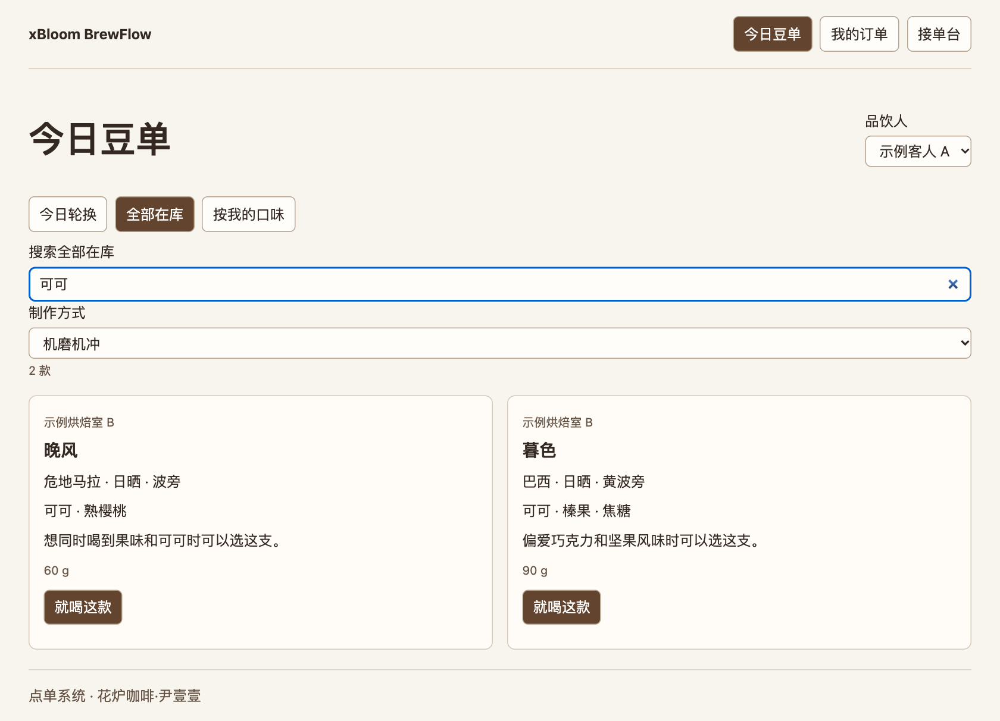
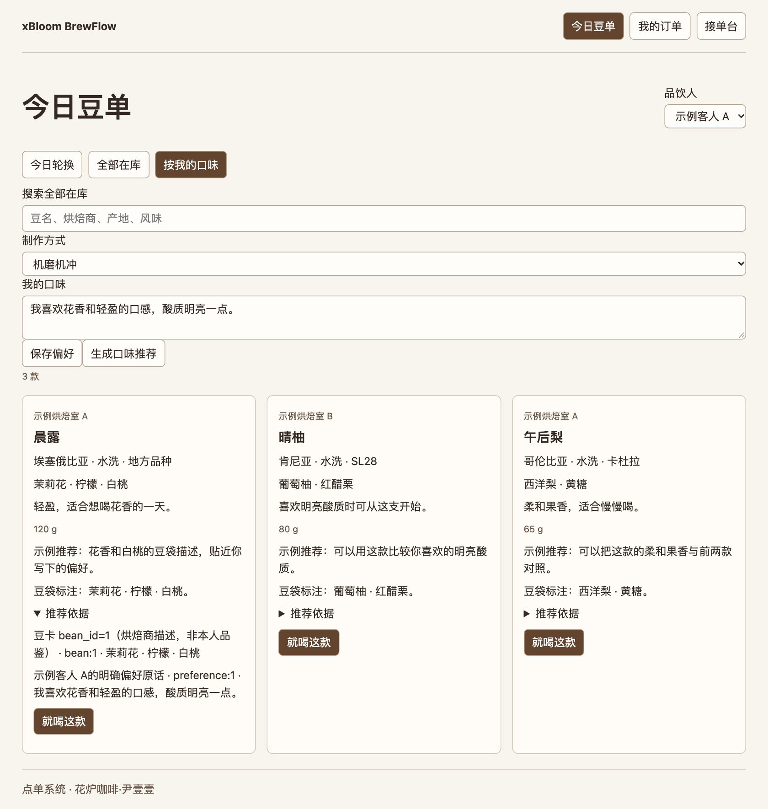
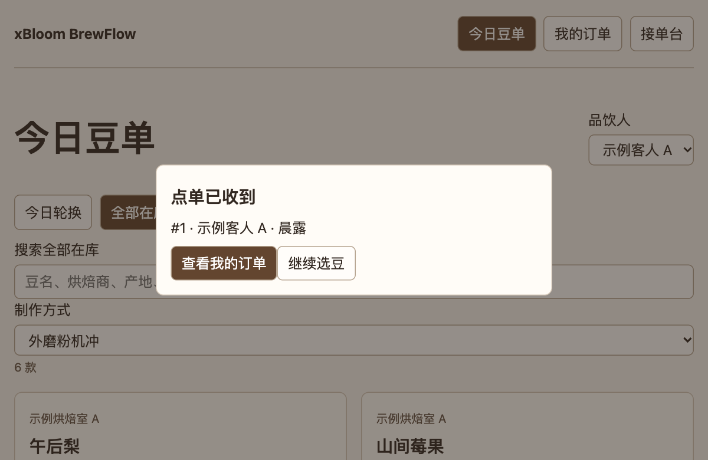
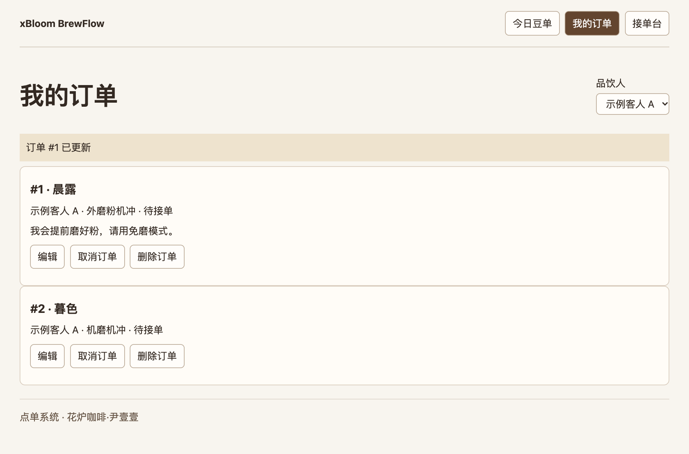
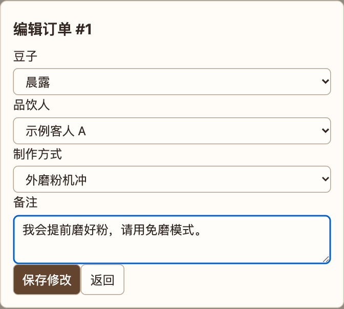
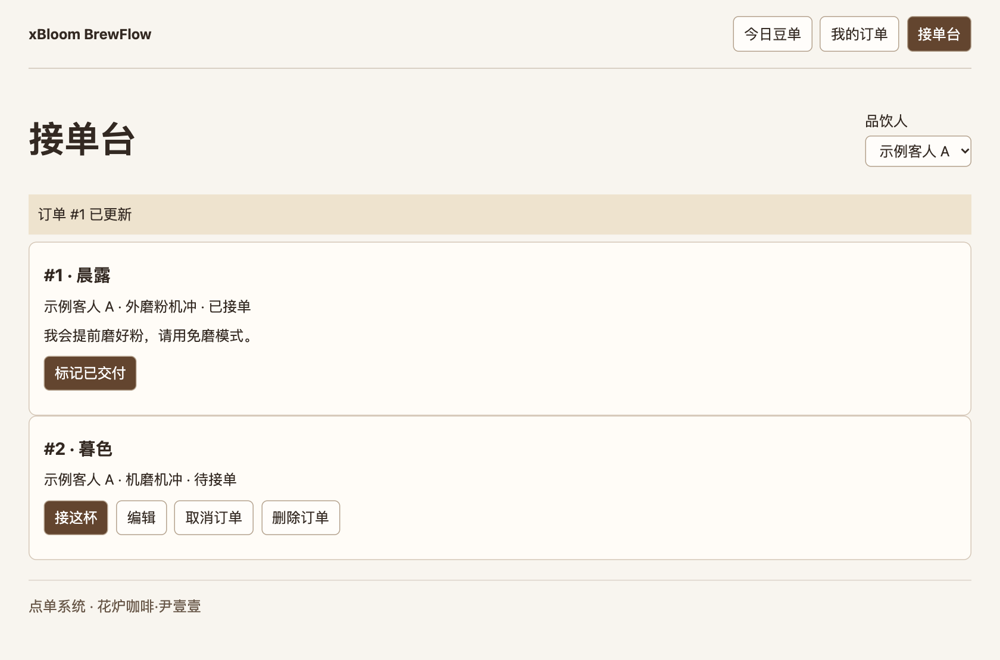
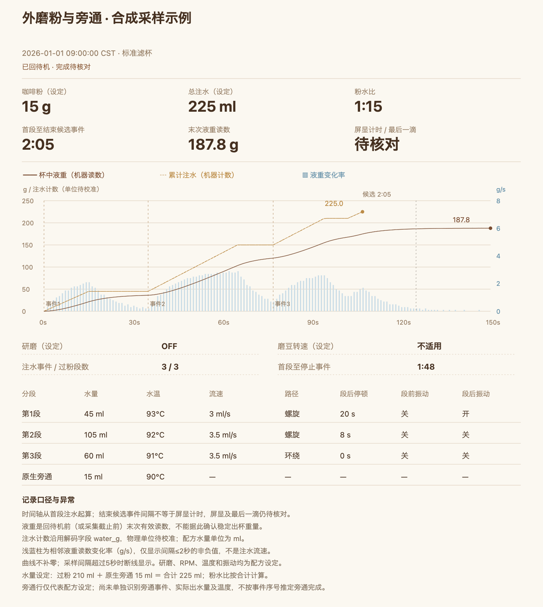

# xBloom BrewFlow

让每一杯都有依据、有记录、有改进。

作者包括 **花炉咖啡·尹壹壹**。

点单网页与本地启动方法见[点单模块](ordering/README.md)。

An agent skill for xBloom Studio: plan recipes, brew over Bluetooth, capture reports, and refine with tasting feedback.

内置一一完整经验库、六层拟方方法，以及发布者的机冲／手冲与个人反馈，支持有案例可查的冷启动。入口见[知识与案例](knowledge/README.md)。

## 第一杯怎么用

你可以用一句平常喝咖啡时会说的话开始。下面是用法示例。

> 今天想喝一杯有花香、入口轻盈的咖啡。我自己磨，交给 xBloom 注水。先告诉我用什么配方、为什么。

1. **选豆。** 在本地点单页看今天轮换的最多五款，或搜索全部在库豆。豆卡上能看到烘焙商、处理法和风味。点单后拿到订单号，制作人到接单台接这杯，再把豆卡、粉量和客人的要求交给冲煮技能。[点单台使用说明](ordering/README.md)
2. **审方。** 先看它参考的是你自己喝过的哪杯，或是哪条外部经验。再看粉量、研磨方式、每段注水和为什么这样选。已经自己磨好粉，就选免磨。配方若使用旁通，分别看过粉水和直接进杯的水，两者影响风味的方式不同。[配方字段说明](references/recipe.md)
3. **冲煮。** 你可以先离线预览。豆子或咖啡粉、滤杯、接液杯和水准备就绪后，再明确开始这一杯。机器回报和杯秤采样会进入报告，报告会标出仍需人工核对的项目。
4. **说说喝到了什么。** 比如“热的时候花香明显，温下来甜感正好，凉了有点收口。下杯想保住甜感。”这句原话就足够开始复盘。制作人可以把这杯作为基准，另存一版，再看同一问题是否改善。

### 尹壹壹的六层冲煮框架

| 框架 | 到你这一杯，具体看什么 |
| --- | --- |
| ① 杯中目标 | 先选你想保住的优点，以及最想改善的一点。比如保住花香，减轻冷后的涩感。 |
| ② 浓度与萃取 | “淡”可能指口感轻，也可能指花果表达弱。先澄清是哪一种。有测量再谈浓度或萃取率的数值。 |
| ③ 参数如何起作用 | 把研磨、水温、分段和粉床排水放在一起解释。每个调整都写清预期收益和可能牺牲的风味。 |
| ④ 选择配方骨架 | 先找同一批豆的记录。初次冲时，用处理法、烘焙和器具接近的案例挑一个起点，标明差异。 |
| ⑤ 按人调整 | 同一杯可以有人喜欢轻盈，也有人觉得薄。各自保存感受，下次按实际饮用人取舍。 |
| ⑥ 用下一杯检验 | 热、温、凉时有变化就记一句。优先改一个可判断的参数，比较新旧两杯；有反例就收窄这条经验的适用范围。 |

例如上面那杯“凉了有点收口”，可以把**只降低尾段水温**列为一次待试调整。下杯同时观察两件事：涩感有没有减轻，想保住的甜感有没有损失。这样即便第二杯没有变好，也能给第三杯留下具体依据。[完整拟方与修方方法](references/yiyi/workflow.md)

### 七套萃取骨架

第④层要做的决定是为这支豆子选一个冲煮起点。七套骨架平权。先看处理法、烘焙和上杯的反馈，再对照图里的段量、温度与研磨方向。



图里的「提 E」表示希望提高萃取率。按原图图例，蓝色①②③⑥已有实测或外部依据，橙色④⑤⑦在制图时还待实测。换到自己的豆子和器具，可以先选最贴近的一套，记下想改善的那一点。

## 实际页面

下面是运行本仓库得到的页面截图。豆名、品饮人和订单均为演示资料。可以按一杯咖啡从选豆到出杯的顺序看，也可以从[本地点单台的启动说明](ordering/README.md)开始自己操作。

**今日豆单**把烘焙商、产地、处理法和袋上风味放在同一张卡上。选好品饮人和制作方式，点「就喝这款」即可下单。



<details>
<summary>选豆：搜索全部在库、查看个人推荐</summary>

在搜索框输入「可可」，范围会切换到全部在库。即使一款豆今天没有进入轮换，也能找到它。



在「按我的口味」保存一句偏好，生成推荐后可展开「推荐依据」。这张截图使用离线示例推荐回执，展示页面怎样呈现豆袋风味和品饮人的原话。



</details>

<details>
<summary>顾客：下单回执、我的订单、编辑订单</summary>

看到「点单已收到」和订单号，就知道这次下单有了回执。点「查看我的订单」可以核对豆子和制作方式。





接单前可以编辑豆子、品饮人、制作方式和备注。例如自己已磨好粉，就可以选择「外磨粉机冲」并留一句说明。



</details>

<details>
<summary>制作人：接单台与当杯冲煮报告</summary>

「接单台」集中显示待接单和已接单的杯子。示例里，「晨露」已接单，制作人能看到客人自磨粉的备注；「暮色」还在等待接单。



下图是由冲煮技能单独生成的 HTML 报告。合成采样展示了累计注水、杯中液重、分段参数和原生旁通。屏显计时与最后一滴保留为「待核对」。



</details>

## 安装

第一版面向 **macOS、Python 3.11+、xBloom Studio 标准滤杯、机磨或外磨粉冲煮流程**。底层使用Bleak；Unix设备锁尚未移植到Windows，Linux硬件流程未验证。其他滤杯或自动切换机器模式不在本版执行范围。

把整个 `xbloom-brewing` 文件夹放进Agent的技能目录。Codex可使用 `~/.codex/skills/xbloom-brewing`，其他Agent可直接读取本目录的 `SKILL.md`。

从本仓库安装到Codex（目标目录应尚不存在）：

```sh
git clone https://github.com/sevenhu20250927-dot/xbloom-brewflow.git ~/.codex/skills/xbloom-brewing
cd ~/.codex/skills/xbloom-brewing
```

仓库名为`xbloom-brewflow`，技能调用名为`xbloom-brewing`。

在本目录创建Python环境：

```sh
python3 -m venv .venv
.venv/bin/python -m pip install -r requirements.txt
.venv/bin/python scripts/xbloom.py --help
```

首次实际连接时，给运行该Python的应用授予macOS蓝牙权限。将个人数据放在技能目录以外，例如 `~/CoffeeWorkspace`。日常对Agent说：

> 用 xbloom-brewing 帮我拟一杯配方，先给我审核。我使用15g豆、标准滤杯，其他条件如下……

> 这杯入口甜、中温略涩。根据刚才记录提出下一版，说明依据。

## 包含什么

- `SKILL.md`：Agent入口与授权边界。
- `references/`：一一的拟方／修方与知识审核流程、类型模板、参数合同和操作口径。
- `knowledge/`：完整来源经验、总账、按豆案例、个人偏好和迁入证据；无需原库存数据库即可阅读。
- `scripts/xbloom_bridge/`：配方校验、BLE编码与状态处理、追加日志、报告和指定目录的总账。
- `examples/`：无个人信息的格式示例，均需按具体豆子审核。
- `tests/`：离线回归与发布包适配用例，使用模拟设备与临时数据。

命令行冲煮技能可独立运行。可选点单网页使用单独的本地 SQLite。随包数据是公开的冷启动快照，不连接作者数据库。反馈由Agent写入本地Markdown，总账只读取调用者指定的日志目录。原始通知可能含设备序列号和地址，分享时由使用者选择范围，不自动上传。

## 可靠性与范围

严格拒绝重复键、未知字段、非法类型、不能精确编码的比例，以及水量不一致；不自动取整。装载与启动分离，启动绑定配方指纹；设备锁避免同一Mac上本桥接器并发控制同一地址。每条命令发送前写日志，无自动重试。

BLE核心从已有macOS／Studio固件`V12.0D.500`的实冲项目抽取，包含本机曾观察成功的原生旁通路径；实际旁通温度尚未独立测量。**发布包当前的验证状态见[验证说明](VALIDATION.md)**，原项目的成功不等于裁剪后的包已验证。

`completion=unconfirmed`保持证据边界：收到ready或结束候选、观察窗口结束，均不自动证明屏显时间、物理最后一滴或已喝到咖啡。报告液重是末次有效读数，取杯与秤状态变化可能影响它。用户反馈和人工核对另记。

已知限制：采集时长由调用者设置，暂不自动延长；完整配方读回、实测水温／RPM／粉量、TDS／EY和物理末滴未实现；评分不自动学习数值权重。读取到的研磨快照不能代表装载后的实际档位。

## 开发验证

跨机器开发先读[开发目录](development/README.md)：[设计目标](development/GOALS.md)与[当前进度／剩余缺口](development/STATUS.md)。运行测试与长期知识闭环的验收范围分开记录。

获得所在环境要求的测试授权后，从本目录执行：

```sh
PYTHONPATH=scripts python3 -B -m unittest discover -s tests -v
```

测试不连接机器。技能结构另可用Codex `skill-creator` 的 `quick_validate.py` 检查（需要PyYAML）。

## 发布到GitHub

将本目录内容作为独立仓库根目录；不把上层咖啡项目一起上传。保留 `LICENSE`、`NOTICE.md` 与协议许可证。`.gitignore`排除本地环境、运行日志、反馈记录和常见数据库；它不替代提交前逐项检查。

公开仓库：[sevenhu20250927-dot/xbloom-brewflow](https://github.com/sevenhu20250927-dot/xbloom-brewflow)。后续修改应完成相应离线验证并如实保留硬件验证范围。使用者的新豆子记录与反馈在个人工作目录中维护，不作为技能更新覆盖。公开的历史种子数据已获提供者同意，新增记录是否公开仍由使用者决定。

本项目为非官方社区工具。协议来源、归属与方法参考见[NOTICE.md](NOTICE.md)。
