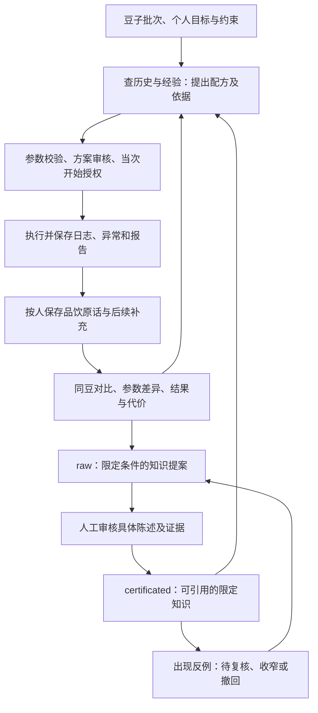

# 设计目标

更新日期：2026-11-12。本文区分用户已确认要求、当前实现事实和待设计事项，作为跨机器开发的共同依据。

## 已确认的目标与依据

用户选择了“完整冲煮闭环：豆子信息、拟方审核、蓝牙执行、报告和反馈；独立于现有库存系统”。随后要求保留一一的技能与经验、个人经验，并允许把冲煮数据作为公开冷启动数据。

用户对可靠性的要求是：尽量把确定性执行交给代码，覆盖异常，减少Agent临场自由发挥。知识侧要求完整参数因果关系、按豆归档、raw与certificated分层，以及可供人审阅的调整依据；不能把经验库缩成症状到参数的词表。

因此目标是：**每杯知道凭什么拟方，实际发生了什么，谁喝到了什么；反馈能回到下一版配方，经过明确审核的限定结论能被后续检索使用。**

图表示目标流程，各环节当前是否已实现以[开发状态](STATUS.md)为准；箭头不代表已有自动程序。

## 不变的设计约束

| 要求 | 依据与必要性 |
| --- | --- |
| 豆子批次、杯次、执行尝试与品饮者应能明确关联 | 同杯重试不能成为多个满意样本；同名不同批、不同人的反馈不能混合 |
| 配方设定、机器回报、人工观察、AI解释分别保存 | 面板研磨、旧快照、取杯导致的重量变化和不同计时口径曾出现差异；不能靠覆盖原值消除冲突 |
| 反馈可补充，修改可追溯，缺失明确保留 | 用户常只喝高温或后来才评价；沉默不是满意，补充不应抹掉原话 |
| 修方展示全部参数差异与依据 | 红尾巴及MARUS存在多参数同时改变；不能用单变量因果解释组合结果 |
| 方案认可、开始授权与知识审核分开 | “愿意试这一杯”不表示某条规律已被证明；开始一杯的许可不延续到下一杯 |
| 历史资料可用于提议，但不能自动认证 | 来源经验中有未复冲建议、冲突和未测量机理；证据强弱要影响使用方式 |
| 已审核知识保留条件与反例 | 换豆、换滤杯、换品饮者后可能失效；应能标记争议并停止作为已成立依据 |
| 新数据不能只写入，还必须能在下杯找到 | 否则只有存档，没有积累；公开种子库与个人新增历史需要清楚的检索路径 |
| 一个事实优先保存一份，其他位置引用 | 日志、配方、评价、网页和知识提案不可各自维护冲突副本；不为未来可能性提前增加框架 |

## 分工与现有资产

- **代码应负责的确定性行为**：参数校验、执行顺序、原始日志、图表、文件与关联检查、反馈保存及修订留痕、知识状态和索引更新。后半段目前仍有缺口，详见状态表。
- **Agent负责的判断**：理解当次目标、检索相关材料、比较候选动作与条件、说明取舍、提出待审调整。可核对的输入、证据、选择和预期必须留痕；不要求保存模型内部思考。
- **人保留的决定**：具体饮用偏好、方案审核、真实开始、实际品饮反馈、对具体知识陈述的认可或否定。

现有方法合同见[工作记录](../references/records.md)、[一一知识闭环](../references/yiyi/knowledge-loop.md)、[杯次／对比／知识记录](../references/yiyi/records.md)。这些是文本合同，不能把它们当成已经实现的程序校验。

## 完成积累闭环应能验收的表现

以下是从上述目标推导的验收方向，**尚未完成验收，也不预定具体Schema或命令名**：

1. 第一杯归档后，能识别资料完整、等待反馈、失败或待核对等实际情况；不知道的内容不必编造为“完整”。
2. 同一杯两人分别评价、用户后来补充中低温反馈，仍能辨认原话、归属与变更；重复保存不重复增加品饮样本。
3. 第二杯明确引用基准与修订版本，能对照全部改动、观察到的改善／代价和未满足条件。
4. 知识提案缺证据或缺具体审核时不能被当作certificated；即使获认可，也只能在指定范围内引用。
5. 第三次出方能找到新增反馈与知识；出现反例后，仍能找到历史，但不能继续把争议结论作为已成立依据。
6. 中途退出或换机器续接，不丢已保存记录，不重复生成同一条反馈或认证。迁移后的路径与引用可检查。

后续离线演练可使用已归档的真实历史，并将新增流程动作明确标为模拟；模拟审核不得进入正式认证库。不能把回放当成新实冲或因果验证。

## 尚未确定的实现与当前范围

- 新增记录继续使用Markdown、增加少量结构化数据，还是采用SQLite：**未决定**。发布包当前使用JSONL、JSON与Markdown；原产品使用SQLite不等于本技能必须依赖它。
- 杯次／人／版本标识的具体字段、保存接口、审核状态迁移及恢复方式：**待设计**。先解决当前三项缺口，不提前建立通用图数据库或自动权重学习。
- 新历史如何增量进入公共种子库、多人并行维护时如何合并：**待设计**；本次迁入是一次快照。
- 跨机器源码开发是当前明确需求；跨机器蓝牙可用性、个人工作区实时同步、库存界面、微信点单等不在本次交接建设范围。
