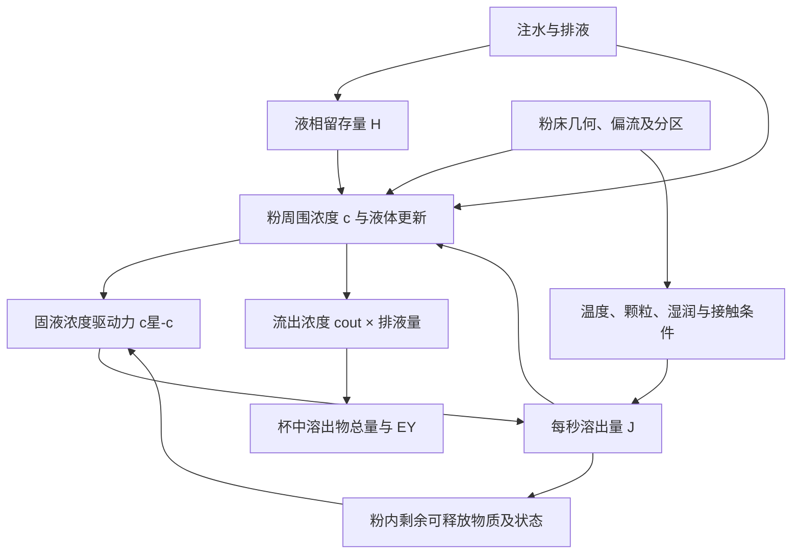

> 来源资料公开副本；保留原文观点、历史条件与待试状态。路径已改写，设备标识已移除。历史命令不作为本技能执行指令。

# 浓度梯度与液体交换模型 · 待本地校准

2026-11-10。身份：文献支持的机理 + 本项目简化模型；未校准、未认证。用户要求“浓度差……合并到模型里”，这是研究与建模授权，不是对本地定量预测的认可。

后续版本：用户明确要求记录并运行[相对萃取模型 v0.1](相对萃取模型-v0.1.md)，采用共享参数与归一化初始物质量作条件性比较。本页保留机理与精确守恒背景；v0.1的稀溶液和单室近似单独列明，不能把相对模拟当作本地实测EY。

## 目标、用途与必要性

消费者是一一知识闭环版的出方与复盘过程。现有日志可以描述进出液，却不能把未出杯量积分直接换算成萃取效果。本补充把液体浓度与溶出量接上，避免用“慢/积水多/面积大”直接推断 EY 高。

原[经验库 §4](../source-snapshot/brew-data-package/reference/冲煮经验库.md)已经提到浓度梯度，但没有把它与本地水量观测建立可计算的守恒关系。这里保留原文作为来源，修正两点：水位不是进出流速之差；滴滤也不能保证各处浓度梯度始终很大。只增加一份模型说明，通过 raw 索引供技能读取；不新建预测引擎、默认系数或数值权重。

## 查到的依据与适用边界

1. [Moroney 等，2019，PLOS ONE](https://journals.plos.org/plosone/article?id=10.1371/journal.pone.0219906)，模型式(8)–(11)：固液浓度差、界面面积和传质系数共同决定溶质转移，流动另外负责输运。其几何分析显示局部萃取可能不均。研究不是 V60/Origami 配对实验，不能借用其结果确认本次滤杯因果。
2. [Moroney 等，2016，Coffee extraction kinetics in a well mixed system](https://pmc.ncbi.nlm.nih.gov/articles/PMC4986356/)：区分表面较快释放和颗粒内部较慢扩散。应用到本项目时，不把整杯传质能力或粉内可释放状态当作固定常数，也不把快慢两部分直接标为酸、甜、苦。
3. [Liang 等，2021，Scientific Reports](https://www.nature.com/articles/s41598-021-85787-1)：全浸泡实验把固液浓度梯度作为动力学驱动力，液体浓度升高会缩小这一驱动力。其长时间平衡实验支持机理理解，不代表约两三分钟的分段滴滤已经平衡；论文拟合常数不移植为本机默认参数。

## 最小影响结构

关键竞争关系：留存更多液体，可能降低相同溶质量下的浓度；排液变慢，也可能减少浓液被新水替换。哪条路径占优取决于先前溶出了多少、液体如何混合与交换，不能仅由 H 的大小确定。

## 可计算关系与假设

下面是本项目对守恒关系和传质驱动的最小化表达，不是直接复制某篇论文，也不是已经能预测本杯的模型。

先把滤杯内液相视为完全混合的一室，暂忽略蒸发、泄漏、悬浮细粉以及单独的吸附/滞留分区。这个假设用于理解；实际偏流时不能套用统一浓度。

| 量 | 定义与单位 | 当前用途及证据 |
|---|---|---|
| H、c | 滤杯内溶液质量 g；其中咖啡溶质质量分数 g/g | 决定液相中有多少溶质；二者均未直接测量，H 不是原图 R |
| Qin、Qout、cin、cout | 进出液质量流率 g/s 及咖啡溶质质量分数 | 守恒输入输出；流率可由日志近似，浓度未知；清水 cin 近似0，一室假设下 cout=c |
| J | 粉向液体的净溶出速率，g咖啡溶质/s | 将浓度差连接到每秒溶出量，未测 |
| K、c星、Mrem | 有效传质能力 g溶液/s；与粉状态对应的液相平衡浓度 g/g；粉内剩余可释放物质 g | 决定驱动力与耗竭；均待标定，c星不等于干粉质量浓度，不预设为固定值 |

传质驱动的一阶近似：

`J(t) = K(t) × [c星(t) − c(t)]`

`dMrem/dt = −J`

两本守恒账同时成立：

`dH/dt = Qin − Qout + J`

`d(Hc)/dt = J + Qin·cin − Qout·cout`

第一式保留粉中溶质进入液相增加的质量。完全混合时可推出：

`H·dc/dt = J·(1−c) + Qin·(cin−c)`

清水进入既增加液量又稀释浓度；溶出增加浓度。Qout 虽在最后一式中抵消，仍通过 H 的变化影响浓度演化。可见不能用 `H×浓度差` 随意替换原积分；需要结合守恒和传质能力。

杯中实际收集的咖啡溶质量：

`M杯 = ∫ Qout(t)·cout(t) dt`

`EY杯(%) = 100 × M杯 / 干粉质量`

它与 `∫J dt` 不必相等，因为溶出的物质可能仍留在粉层液体里。若只需最终 EY，不必测每秒浓度：最终均匀咖啡液的质量 × TDS质量分数可估计 M杯。TDS测量需考虑水本底与测量条件。全局 EY 仍不能单独代表局部均匀性或某一种苦涩物质的含量。

## 100 与 110 的条件推理

用户用100和110说明机理；下述是条件例子，不是这两杯的实测数据：若两份参与交换的溶液质量为100g与110g，且已溶出的咖啡物质质量相同，则后者浓度为前者的100/110，约低9.1%。只有再假设粉内状态、K及接触情况相同，才能说后者当时的浓度驱动力更大。

真实两杯不保证“已溶出量相同”，因此9.1%不是本次萃取改善幅度，也不能从它推出最终EY增幅。本模型不生成未经校准的百分比。

## 接回本地红尾巴记录

对应[两杯留存量曲线与积分](../log/红尾巴-实验日晒-AG82/滞留量估算-20261109-20261110.md)。

- 原 R=W−B 及面积仅保留为进出液差额指标，不能称为萃取能量。完整记录面积差约0.6%、同窗约11.0%，均不能证明萃取效果接近或相差这些百分比。
- 用户补充“实际上已经排空了”作为现场观察保留。具体排空时刻仍未知。排空后R不为零不等于还有可自由排出的水；也不能把末端R直接当作整段恒定吸水量并从全曲线扣除。
- 现有输入：两杯注水计数、液重、时间与配方设定。未知：液相/出口浓度曲线、实际粉床温度、可交换液量、K、粉内状态与偏流。不同浓度轨迹可以对应相近水量曲线，仅靠现有日志无法唯一反推这些量。
- 现阶段输出：条件性的影响方向和候选解释；无本地 EY 预测值。若要比较最终 EY，补最终稳定液重与混匀后的 TDS；若要判断是哪一段改变了萃取，再考虑分段出液质量和浓度。单个最终TDS也不足以唯一校准全部动力学参数。

审核状态：已按用户要求纳入 raw 索引，供后续出方和复盘共同阅读；尚未通过本地实测校准或知识认证。本次不修改实机执行、配方参数或原始来源。
